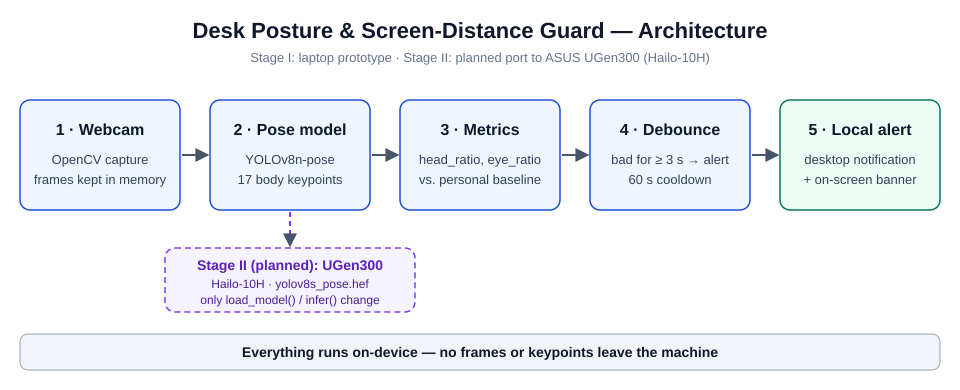

# Desk Posture & Screen-Distance Guard

A fully local webcam tool that reminds you when you **slouch** or sit **too close to the screen**.
Built for the *ASUS UGen AI League* (Everyday AI, Battlefield Lightning). Stage I is a laptop
prototype; Stage II plans to run the same pose model on an **ASUS UGen300** (Hailo-10H).

## Why on-device?

A posture monitor needs a camera pointed at you all day. Sending that video to the cloud is a
privacy risk, so this tool keeps every frame and keypoint on your own machine and only shows a
local notification.

## How it works



1. **Capture** webcam frames with OpenCV.
2. **Detect** 17 body keypoints with YOLOv8-pose.
3. **Measure** two scale-free ratios from the keypoints:
   - `head_ratio` = (shoulder-midpoint y − ear-midpoint y) / shoulder width. It shrinks when you slouch.
   - `eye_ratio` = eye distance / frame width. It grows when you lean toward the screen.
4. **Compare** against your own baseline, recorded in the first 5 seconds (sit upright at a normal distance).
   Slouching is flagged below 85 % of baseline `head_ratio`; "too close" above 125 % of baseline `eye_ratio`.
5. **Debounce**: an issue must last 3 s before alerting, with a 60 s cooldown per issue type.
6. **Alert** with a desktop notification and an on-screen banner.

## Quick start

Python 3.12 is recommended (very new Python versions may lack prebuilt wheels for NumPy/PyTorch).

```bash
python -m venv .venv
# Windows: .venv\Scripts\activate    macOS/Linux: source .venv/bin/activate
python -m pip install -r requirements.txt
python posture_guard.py                  # webcam 0
python posture_guard.py --source demo.mp4  # or a video file
```

The first run downloads `yolov8n-pose.pt` once (internet needed only for that step).

**Keys:** `c` recalibrate · `q` quit. Thresholds are constants at the top of `posture_guard.py`.

## Limitations

- A front-facing webcam gives a proxy estimate, not a clinical neck-angle measurement.
  This is a reminder tool, not a diagnostic one.
- Needs the face and both shoulders visible; otherwise it shows "No reliable pose".
- Laptop FPS shown in the demo is **not** a UGen300 benchmark.

## Roadmap (Stage II)

- Replace `load_model()` / `infer()` with HailoRT running `yolov8s_pose.hef` on UGen300.
- Measure latency and power on the device and add the results here.
- Add per-user threshold tuning and a daily summary report.

## License

MIT
